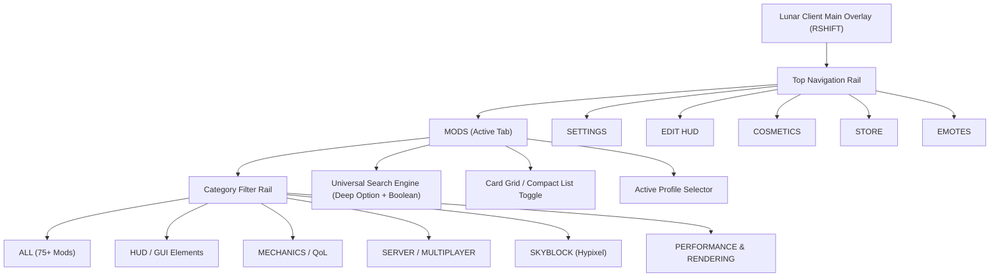
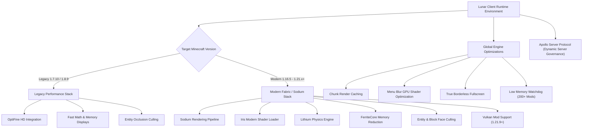

# Deep Research Report: Lunar Client Mod Menu Architecture, UI/UX Systems, and Technical Takeaways for RawCraft

> **Document Status**: Production Research / Architecture Reference  
> **Target File**: `docs/research/lunar-client-mod-menu.md`  
> **Subject**: Lunar Client In-Game Mod Menu, HUD Layout Engine, Configuration Pipelines, and Optimization Architecture  
> **Audience**: RawCraft Launcher Core Engineering & UI/UX Pair Programming Team  

---

## 1. Executive Summary & Overview

**Lunar Client** (developed by Moonsworth, LLC) is widely recognized as the industry benchmark for client-side Minecraft optimization and in-game utility management. Operating across Minecraft versions spanning from legacy release `1.7.10` through the latest modern iterations (`1.21.x` and `26.x`), Lunar Client unifies over **75+ built-in utility, combat, HUD, and quality-of-life modifications** under a proprietary, responsive graphical user interface.

Rather than relying on third-party in-game config screens (such as Minecraft Forge's legacy `GuiConfig` or Fabric's `Cloth Config` / `Mod Menu`), Lunar Client abstracts all modular features behind a custom hardware-accelerated OpenGL / NanoVG rendering engine. This provides players with an unified design language characterized by:
- Non-intrusive HUD element manipulation with real-time screen snapping.
- Deep, categorized mod configuration sub-menus with live previews.
- An extensible profile management layer stored in JSON and synchronized to the cloud.
- Direct runtime enforcement via the server-side **Apollo protocol**.
- Hybrid mod loading supporting native Fabric and Forge `.jar` additions alongside built-in client modules.

This document presents a comprehensive, evidence-backed architectural investigation of Lunar Client's Mod Menu, HUD Editor, and configuration pipeline, concluding with concrete, actionable recommendations for the **RawCraft** launcher engine.

---

## 2. Access Modalities & Hotkey Defaults

```
+-----------------------------------------------------------------------------------+
| MINECRAFT VIEWPORT                                                                |
|                                                                                   |
|    [ ESC Key ] ------------> MINECRAFT PAUSE MENU                                |
|                               +-----------------------------+                     |
|                               | Back to Game                |                     |
|                               | [ LUNAR CLIENT OPTIONS... ] |---> OPENS OVERLAY   |
|                               | Options...                  |      MOD MENU       |
|                               | Disconnect                  |         ^           |
|                               +-----------------------------+         |           |
|                                                                       |           |
|    [ Right Shift (RSHIFT) ] ------------------------------------------+           |
|                                                                                   |
+-----------------------------------------------------------------------------------+
```

### 2.1 Primary Hotkey Mechanics (`Right Shift`)
- **Default Trigger**: By default, Lunar Client maps its GUI overlay to the **`Right Shift` (`RSHIFT`)** key.
- **Input Interception**: When pressed in-game, the client intercepts the Minecraft keyboard event loop prior to camera or movement handling, releases cursor capture (`Mouse.setGrabbed(false)`), and renders the top-level GUI overlay over the frozen or live game viewport.
- **Rebinding Architecture**:
  - Players can rebind this keybind either in the vanilla Minecraft *Options > Controls* screen or directly within the *Lunar Client Settings > General > Keybinds* tab.
  - The key picker supports single-key inputs, mouse buttons (`Button 3`, `Button 4`, `Button 5`), Function keys (`F1`–`F12`), and special keys (e.g., `GRAVE`, `CAPS_LOCK`).
  - Pressing `ESC` while hovering a key selector unbinds the key, reverting it to `[ NONE ]`.

### 2.2 Pause / Esc Menu Integration & Main Menu Entrypoints
1. **In-Game Pause (`ESC`) Menu**:
   - Lunar Client hooks the Minecraft vanilla pause screen (`GuiIngameMenu` / `PauseScreen`).
   - A branded **`Lunar Client Options...`** button (featuring the Lunar crest) is injected into the pause button stack. Clicking this button immediately launches the mod overlay menu without needing to remember the hotkey.
   - For users running external mods that clash with custom pause layouts, Lunar Client provides a **`Theme Settings > Vanilla (Overlay)`** toggle to revert pause buttons to native positions while keeping the overlay functional.
2. **Main Menu (Title Screen) Integration**:
   - The title screen includes a prominent Lunar Client button and top-right toolbars.
   - A dedicated **Paintbrush Icon** in the top-right corner opens the **Select Theme** and **Theme Settings** menus, allowing players to customize client themes (Modern Dark, Modern Light, Chroma, Classic Lunar, Seasonal) and launcher-in-game handoffs.

### 2.3 GUI Scaling & DPI Multi-Resolution Adaptation
- **Minecraft GUI Scale Synchronicity**: Lunar Client respects the global Minecraft `GUI Scale` setting (`Options > Video Settings > GUI Scale`: Auto, 1, 2, 3, 4).
- **Dedicated "Use Minecraft GUI Scale" Mod Option**: Recent game updates (Changelog 2.22.x–2.23.x) added a per-mod toggle, `Use Minecraft GUI Scale`. When disabled, HUD elements decouple from global game scaling, allowing high-resolution 1440p and 4K displays to display compact, razor-sharp HUD widgets without oversized UI bloat.
- **High-DPI / Retinal Screen Fixes**: Specific patches address 1440p and 4K font rasterization to eliminate blurry text, ensuring vector-like rendering across text labels, sliders, and borders.

---

## 3. Information Architecture & Navigation System



### 3.1 Primary Navigation Tabs
The top header bar provides persistent navigation across six major functional domains:
1. **`MODS`**: The central repository for discovering, toggling, and configuring all built-in and external client features.
2. **`SETTINGS`**: Global client preferences, including keybinding management, notification toggles, Discord Rich Presence, theme selection, and memory/telemetry displays.
3. **`EDIT HUD`**: Full-screen interactive layout canvas for repositioning, scaling, and snapping on-screen HUD elements.
4. **`COSMETICS`**: Real-time locker for cloaks, wings, backpacks, hats, masks, and pet animations tied to the player's Moonsworth account.
5. **`STORE`**: In-game storefront for browsing and acquiring official cosmetic bundles.
6. **`EMOTES`**: Radial wheel and keybind assigner for player animations.

### 3.2 Mod Categorization & Sub-Taxonomy

| Category Tab | Primary Purpose | Key Built-In Modifications Included |
| :--- | :--- | :--- |
| **`ALL`** | Unfiltered repository | Complete alphabetical catalog of all 75+ modules |
| **`HUD / GUI`** | On-screen telemetry & visual status indicators | `FPS`, `CPS`, `Keystrokes`, `Armor Status`, `Potion Effects`, `Coordinates`, `Direction HUD`, `Stopwatch`, `Item Tracker`, `Ping`, `Scoreboard`, `Boss Bar`, `Crosshair`, `Tab Editor`, `Hotbar Customizer`, `Locator Bar` (1.21.6+) |
| **`MECHANICS`** | Movement, inventory & physics tweaks | `Toggle Sneak/Sprint`, `Freelook`, `Snaplook`, `Zoom`, `Scrollable Tooltips`, `Item Physics`, `Container Animations`, `Auto Text Hot Key`, `Modern Keybind Handling`, `Inventory Search` |
| **`SERVER`** | Mini-game integration & network tools | `Hypixel Stats` (Bedwars, Duels, Skywars, Murder Mystery), `Hypixel Quickplay`, `Team View`, `Auto Tip`, `Auto Who`, `Server Links`, `Apollo Server Protocol Handlers` |
| **`SKYBLOCK`** | Hypixel SkyBlock automation & solvers | `Etherwarp Preview`, `Slayer Boss Alert`, `Composter Helper`, `Garden Visitor HUD`, `Greenhouse Growth HUD`, `Dungeon Solvers`, `Gemstone Profit HUD`, `Hoppity's Egg Hunt` |
| **`PERFORMANCE`** | Frame rate, memory, and engine optimizations | `Sodium Engine`, `Iris Shaders`, `OptiFine HD` (legacy), `Entity Culling`, `Block Face Culling`, `Chunk Render Cache`, `Menu Blur Optimization`, `Borderless Fullscreen` |

### 3.3 Search Architecture: Deep-Option Indexing & Boolean Operators
Lunar Client's search bar features two notable innovations:
1. **Deep Option-Level Indexing**:
   - The search input does not merely match top-level mod names (e.g. "Keystrokes").
   - Typing `"CPS"`, `"Spacebar"`, or `"Fade Delay"` matches the **Keystrokes** mod because those terms exist as child options inside its configuration schema.
2. **Boolean Search Expressions** (Game Changelog 2.23.2):
   - Supports logical syntax: `|` (OR), `&` (AND), and `!` (NOT).
   - Enables queries like `fps | ping` or `hud & !hypixel` directly within the mod and inventory search engines.

---

## 4. Mod Card Component Anatomy & State Management

```
+-------------------------------------------------------------+
| [★] KEYSTROKES                                 [⚙ SETTINGS] |
|     Renders real-time keyboard and mouse inputs on-screen   |
|                                                             |
| [ HUD ] [ PVP ]                                  [ ENABLED] |
+-------------------------------------------------------------+
```

### 4.1 Card Anatomy & Interactive Zones
Each mod card in the grid layout is a self-contained card component containing:
1. **Favorite / Pin Star (`[★]`)**:
   - Located at the top-left or title flank.
   - Clicking pins the mod to the **Pinned Section** at the very top of the `ALL` tab and respective category tabs, persisted across restarts.
2. **Mod Title & Category Badges**:
   - High-contrast, clean sans-serif typography (`Roboto` / `Panton`).
   - Compact visual chips indicating tags: `[ HUD ]`, `[ MECHANICS ]`, or `[ 1.8 ONLY ]`.
3. **Gear / Settings Button (`⚙`)**:
   - Positioned in the upper-right corner.
   - Clicking executes a smooth horizontal slide transition into the **Mod Settings Sub-Menu**.
4. **Primary Toggle Switch**:
   - High-visibility pill switch located at the bottom-right.
   - **Enabled State**: Vibrant green background (`#3BBE54` / `#00FF65`) with right-aligned toggle indicator and label `ENABLED`.
   - **Disabled State**: Dark charcoal / muted red background with left-aligned toggle indicator and label `DISABLED`.
   - Clicking toggles the runtime module instantly without requiring a client restart.

### 4.2 Compact vs. Expanded Grid Views
- **Card Grid View (Default)**: 2 or 3 columns of rectangular cards with full descriptions and large toggle targets, suited for discoverability.
- **Compact List View**: Single-row data tables showing only the Favorite Icon, Mod Title, Quick Tag, Settings Cog, and Toggle Switch, maximizing information density for advanced competitive players.

### 4.3 Apollo Server-Enforced States
When connected to a server running Lunar Client's **Apollo API**, certain mods may be forcibly disabled or locked by the server operator (e.g., `Freelook` or specific minimap radars in competitive arenas). In this scenario:
- The mod card displays a **Locked / Server Disabled** lock icon.
- The toggle switch is rendered in a disabled state (`#CCCCCC` / `#636075`) with an explanatory tooltip: *"Disabled by current server policy via Apollo."*

---

## 5. Mod Settings Sub-Menu (Deep Configuration Screen)

```
+-----------------------------------------------------------------------------------+
| [< BACK TO MODS]   KEYSTROKES SETTINGS                           [ENABLED (TOGGLE)]|
+-----------------------------------------------------------------------------------+
|  [ SEARCH OPTIONS...                                                            ] |
+----------------------------------------------------+------------------------------+
| CONFIGURATION ACCORDIONS                           | LIVE DYNAMIC PREVIEW         |
|                                                    |                              |
| v GENERAL SETTINGS                                 |     +-----+                  |
|   Show Mouse Clicks ..................... [ ON ]   |     |  W  |                  |
|   Show Space Bar ........................ [ ON ]   |  +--+--+--+--+               |
|   Show CPS .............................. [ ON ]   |  |  A  |  S  |  D  |         |
|                                                    |  +-----+-----+-----+         |
| > BACKGROUND & BORDER                              |  |   LMB    |   RMB    |     |
|   Background Color ............ [ ■ #151515E0 ]    |  |  8 CPS   |  0 CPS   |     |
|   Border Thickness ...................... [ 1px ]  |  +----------+----------+     |
|                                                    |  |       SPACEBAR      |     |
| v COLOR & CHROMA                                   |  +---------------------+     |
|   Text Color .................. [ ■ #00FF65   ]    |                              |
|   [✓] Enable Chroma (Rainbow Effect)               | Live changes reflect         |
|   Chroma Speed ................ [====o====] 4.5x   | instantaneously here.        |
|                                                    |                              |
+----------------------------------------------------+------------------------------+
```

### 5.1 Hierarchical Grouping & Accordion Sections
When clicking the gear icon on a mod card, the client transitions into a dedicated sub-menu. Settings are organized into collapsible accordion sections:
- **`General`**: Core behavioral flags (e.g., show/hide specific sub-elements).
- **`Appearance / Fonts`**: Font selection (Minecraft pixel font vs. Modern smooth font), text shadow, uppercase transforms.
- **`Background & Border`**: Background opacity, corner radius, border width, inner/outer padding.
- **`Colors`**: Independent color assignments for text, background, pressed state, and border.
- **`Positioning & Scale`**: Manual coordinate tuning (`X`, `Y`), scale sliders, and vanilla anchor locks.

### 5.2 Control Primitives

| Component Type | Visual Presentation | Behavioral Specification |
| :--- | :--- | :--- |
| **Boolean Toggle** | Pill-shaped slide switch | Binary on/off state; triggers immediate UI repaint |
| **Numeric Slider** | Horizontal track with draggable pill thumb | Displays floating-point or integer value alongside track; supports click-drag or direct numerical entry |
| **Dropdown Select** | Flat select box with chevron | Single-choice enum picker (e.g., Text Alignment: `LEFT`, `CENTER`, `RIGHT`; Time Format: `12-HOUR`, `24-HOUR`) |
| **Keybind Picker** | Push button displaying current key name | Click to enter listening mode (`"Press a key..."`); captures keydown event; `ESC` clears |
| **Text Input** | Single-line text input field | String customization (e.g., custom prefix `FPS: `, date formats, coordinate patterns) |

### 5.3 Advanced Color Picker & Chroma Engine
The Lunar Client color picker provides comprehensive color management:
1. **Interactive Spectrum**: 2D saturation/value box paired with a vertical hue slider.
2. **Direct Value Inputs**: Real-time Hex code input (`#RRGGBB` or `#RRGGBBAA`) and individual RGBA integer fields (0–255).
3. **Opacity / Alpha Slider**: Granular transparency control for background fills and borders.
4. **Chroma / Rainbow Engine**:
   - Toggle to enable an animated RGB wave across HUD elements.
   - **Chroma Speed Slider**: Controls wave cycle frequency from 1.0x to 10.0x.
   - **Color Propagation**: Includes `"Apply to All"` and `"Copy from Normal"` utilities to synchronize color schemes across multiple HUD mods with a single click.

### 5.4 Live Dynamic Preview Pane
For visual HUD mods (Keystrokes, Armor Status, Coordinates, Crosshair), the settings screen renders a live, interactive preview canvas on the right side of the screen. Adjusting a color, slider, or font immediately updates the preview widget, eliminating the need to exit the menu to verify visual appearance.

---

## 6. In-Game HUD Layout & GUI Editor ("Edit HUD")

```
+-----------------------------------------------------------------------------------+
| [ SNAP TO GRID: ON ]  [ GRID SIZE: 8px ]  [ LOCK HUD: OFF ]    [ RESET ALL ] [DONE]
|                                                                                   |
|  +----------------------+                                                         |
|  | [FPS: 240]           |  <- (Draggable Widget with corner scaling dots)        |
|  +----------------------+                                                         |
|             :                                                                     |
|             : (Magnetic Snapping Guide Line)                                      |
|             v                                                                     |
|  +----------------------+                                                         |
|  | [XYZ: 124, 64, -280] |                                                         |
|  +----------------------+                                                         |
|                                                                                   |
|                                                  (Center Screen Guide)            |
| - - - - - - - - - - - - - - - - - - - - - - - - - - - - | - - - - - - - - - - - - |
|                                                         |                         |
|                                                                                   |
+-----------------------------------------------------------------------------------+
```

### 6.1 Viewport Overlay & Bounding Boxes
Clicking **`EDIT HUD`** (or pressing hotkey `M`) enters layout canvas mode:
- The game world is rendered with a subtle darkening overlay to emphasize UI widgets.
- Every active HUD mod displays a distinct bounding box with corner control handles.
- Inactive mods can be enabled directly from this screen via a floating `+ Add Element` drawer.

### 6.2 Magnetic Snap-to-Grid & Smart Alignment Guides
- **Magnetic Alignment Guides**: When dragging a HUD element, dynamic cyan/red guide lines appear when the element's edges or center align with:
  1. The vertical or horizontal center of the screen.
  2. The edges of the viewport (with configurable margin padding).
  3. Neighboring HUD elements (matching tops, bottoms, lefts, or rights).
- **Grid Snapping**: A toggleable grid allows discrete pixel-stepping (e.g., 4px, 8px, 16px grid units) for symmetrical positioning.

### 6.3 Dynamic Rescaling & Drag Handles
- **Interactive Drag Handles**: Clicking and dragging the corner dots of any bounding box dynamically rescales the element between **`0.5x`** and **`2.0x`** scale.
- **Scroll Wheel Scaling**: Hovering over any element and scrolling the mouse wheel adjusts its scale up or down in discrete 0.05x increments.

### 6.4 Editor Toolbar & Safeguards
- **`Lock HUD`**: Freezes all element coordinates to prevent accidental displacement during gameplay.
- **`Lock to Vanilla Position`**: Automatically anchors vanilla HUD elements (hotbar, health, armor, food bar, air bubbles) to their default Minecraft positions.
- **`Reset Element / Reset All`**: Instantly restores widgets to factory default positions and scales if an element is dragged off-screen.

---

## 7. Profiles, Presets, & Configuration Storage

### 7.1 Local Filesystem Architecture
Lunar Client persists all mod states, HUD positions, and options in standard JSON schemas located within the user's home directory:

```
[Windows]: %USERPROFILE%\.lunarclient\settings\game\
[macOS]:   ~/.lunarclient/settings/game/
[Linux]:   ~/.lunarclient/settings/game/
  │
  ├── profile_manager.json          <-- Master registry of all profiles
  │
  ├── Profile1712938472/             <-- Unique profile directory
  │   ├── mods.json                 <-- Enabled states, mod options, HUD coordinates
  │   └── options.txt               <-- Vanilla Minecraft options clone
  │
  └── Default/
      └── mods.json
```

#### Schema: `profile_manager.json`
```json
{
  "profiles": [
    {
      "name": "Default",
      "displayName": "Default Layout"
    },
    {
      "name": "Profile1712938472",
      "displayName": "Competitive PvP"
    },
    {
      "name": "Profile1712938599",
      "displayName": "Hypixel SkyBlock"
    }
  ],
  "selected": "Profile1712938472"
}
```

#### Schema: `mods.json` (Exemplar Keystrokes & FPS Record)
```json
{
  "keystrokes": {
    "enabled": true,
    "scale": 1.0,
    "position": {
      "x": 12.0,
      "y": 120.0,
      "anchor": "TOP_LEFT"
    },
    "options": {
      "show_mouse": true,
      "show_space": true,
      "show_cps": true,
      "chroma": false,
      "text_color": "#FFFFFFFF",
      "background_color": "#151515B0"
    }
  },
  "fps": {
    "enabled": true,
    "scale": 1.15,
    "position": {
      "x": 10.0,
      "y": 10.0,
      "anchor": "TOP_LEFT"
    },
    "options": {
      "use_minecraft_scale": false,
      "custom_prefix": "FPS: ",
      "text_color": "#00FF65FF"
    }
  }
}
```

### 7.2 Profile Lifecycle & Portability
- **Create / Clone / Delete**: Users can generate isolated profiles dedicated to specific gameplay modes (e.g., a minimal HUD for Survival, a stat-heavy HUD for SkyBlock).
- **Context Menu Actions** (Changelog 3.7.23):
  - **`Export Profile`**: Serializes the profile folder into an exportable package.
  - **`View Mods`**: Shows an indexed breakdown of all active mods within the profile.
  - **`Show in File Explorer`**: Directly opens the active profile folder on disk.
- **Third-Party Imports**: Built-in parsers support importing profiles from legacy launchers and community formats (such as Dawn Client profile packages).

### 7.3 Cloud Synchronization & Moonsworth Account Federation
When signed into a Lunar Client account via the launcher, active profiles automatically synchronize with Moonsworth cloud services. Profile state changes made on one machine propagate to secondary desktop environments, ensuring seamless continuity across workstations.

---

## 8. Performance Engine & Optimization Framework



### 8.1 Dual-Engine Strategy
Lunar Client dynamically adjusts its rendering pipeline depending on the selected Minecraft version:
1. **Legacy Architecture (`1.7.10`, `1.8.9`, `1.12.2`)**:
   - Integrates **OptiFine HD** as the core graphics engine.
   - Bundles legacy speedups: Fast Math, Lazy Chunk Loading, Particle Limiters, and legacy 1.7 animation restores.
2. **Modern Architecture (`1.16.5` through `1.21.x` and `26.x`)**:
   - Replaces OptiFine with **Sodium**, delivering modern OpenGL multi-draw chunk meshing.
   - Integrates **Iris** for modern shader execution with minimal frame rate penalties.
   - Embeds **Lithium** (physics/AI optimization) and **FerriteCore** (deep JVM memory footprint reduction).
   - Introduces **Vulkan Mod** experimental support (Changelog 2.23.3) for next-generation Vulkan API rendering.

### 8.2 Occlusion & Culling Pipeline
- **Entity Culling**: Omits rendering of entity models (players, mobs, chests, item frames) that are blocked by solid geometry or located outside the player's immediate field of view, significantly reducing draw calls in high-density areas (such as Hypixel Bedwars lobbies or SkyBlock hubs).
- **Block Face Culling**: Skips rendering of non-visible block faces between adjacent occluded blocks.

### 8.3 System & Memory Optimizations
- **Chunk Render Caching**: Caches static chunk meshes on the GPU, yielding notable FPS improvements in versions `26.2`–`26.3`.
- **True Borderless Fullscreen**: Operates as a seamless borderless window, eliminating black flashes, desktop stuttering, and mouse cursor desynchronization when alt-tabbing.
- **Low Memory Watchdog**: Detects when a modpack profile loads over 200+ external mods and proactively warns the user if JVM heap allocation (`-Xmx`) is insufficient.

### 8.4 Server-Side Governance: The Apollo Protocol
Lunar Client provides an official open-source server API called **Apollo** (`github.com/LunarClient/Apollo`), utilizing **Protocol Buffers** (`buf.build/lunarclient/apollo`):
- Servers transmit protocol packets that programmatically toggle, configure, or lock client mods.
- Features managed via Apollo include: Custom Nametags, Waypoint beams, Border boundaries, Cooldown timers, Staff inspection mods, and custom Combat rules.

---

## 9. Architectural Comparison & Strategic Takeaways for RawCraft

### 9.1 Comparative Architectural Matrix

| Architectural Feature | Lunar Client | RawCraft Launcher (`v1.0.0`) | Strategic Recommendation for RawCraft |
| :--- | :--- | :--- | :--- |
| **Execution Domain** | In-Game GUI Overlay (OpenGL / NanoVG) | Desktop Pre-Launch Launcher (React 19 + TypeScript) | Bridge desktop management with structured config editing |
| **Design Language** | Sleek Dark Mode with Glows & Rounded Pills | Misty Glassmorphism + Rawblock Brutalism (Zero `border-radius`, 1/3/5px borders) | Retain strict brutalist/glass identity while adopting Lunar's information density |
| **Mod Categorization** | All, HUD, Mechanics, Server, Skyblock, Performance | Instance Files (`MODS`, `RESOURCEPACKS`, `SHADERPACKS`) + Modrinth Type Facets | Add functional category tags (`PERFORMANCE`, `QOL`, `HUD`, `SHADERS`) to local files |
| **Configuration Model** | Runtime Sub-Menus with live interactive preview | Binary file enable/disable on disk (`<name>.jar` vs `<name>.jar.disabled`) | Introduce a Pre-Launch Config Inspector for editing `.json` / `.toml` configurations |
| **Search Capabilities** | Deep Option-Level Indexing + Boolean Operators (`|`, `&`, `!`) | Simple substring matching across installed files | Implement tokenized search supporting category chips and status filters |
| **Profile Management** | Master `profile_manager.json` + `mods.json` directories | Instance directory isolation (`/instances/<id>/`) | Implement **Instance Mod Presets** within each instance |
| **Optimization Stack** | Hardcoded/Bundled Sodium, Iris, Lithium | User must manually search & download individual mods from Modrinth | Provide **One-Click Curated Optimization Bundles** via Modrinth API |
| **Third-Party Ecosystem** | Curated Fabric Add-on + Local `.jar` drag-and-drop | Native Modrinth API integration (`GET /v2/search`) + `.mrpack` modpack extraction | Maintain Modrinth native edge; add bulk-dependency resolution |

---

### 9.2 Recommendation 1: Instance-Scoped Mod Presets (Profile System)

#### The Problem
Currently, RawCraft users configure an instance by manually toggling individual checkboxes for each `.jar` file. When a user wants to transition an instance from "Competitive PvP" to "Cinematic Shaders" or "Vanilla+", they must manually toggle dozens of individual checkboxes.

#### The Lunar-Inspired Solution
Implement an **Instance Mod Preset Engine** within RawCraft:
- Store preset state profiles in `/instances/<profile-id>/presets.json`.
- A preset captures a named state: an array of enabled `.jar` filenames, active resource packs, and active shaderpacks.
- Users can switch presets instantly via a dropdown pill in **Column 02 // Workspace Tabs**.

```json
{
  "activePreset": "competitive-pvp",
  "presets": [
    {
      "id": "competitive-pvp",
      "name": "Competitive PvP (High FPS)",
      "enabledMods": ["sodium-0.5.jar", "lithium-0.12.jar", "ferritecore-6.0.jar"],
      "enabledResourcePacks": ["faithful-32x.zip"],
      "enabledShaderPacks": []
    },
    {
      "id": "cinematic-shaders",
      "name": "Cinematic Shaders (Iris + Complementary)",
      "enabledMods": ["sodium-0.5.jar", "iris-1.7.jar", "entityculling-1.6.jar"],
      "enabledResourcePacks": ["faithful-32x.zip"],
      "enabledShaderPacks": ["ComplementaryReimagined_r5.zip"]
    }
  ]
}
```

---

### 9.3 Recommendation 2: High-Density Mod Cards & Local Status Chips

#### The Problem
RawCraft's local mod list (Tab A) currently renders simple file rows. Users cannot tell which mods are optimization tools, visual tweaks, or content additions without reading file names.

#### The Lunar-Inspired Solution
Refactor RawCraft's local mod checklist items into **High-Density Mod Cards** adhering strictly to RawCraft's visual guidelines (`border-radius: 0px`, `box-shadow: none`, 1px solid `#000000` / `#FFFFFF1A` borders):
1. **Title & Version**: Extracted from the `.jar` metadata (`fabric.mod.json` or `neoforge.mods.toml`).
2. **Category Chip**: Visual text badge (`[ PERFORMANCE ]`, `[ HUD ]`, `[ CONTENT ]`).
3. **Pin to Top (`[★]`)**: Allows users to pin primary mods to the top of the local file manager.
4. **Instant Toggle Checkbox**: 20x20px square brutalist checkbox (`[✓]`) that executes file renaming (`.jar` <-> `.jar.disabled`).
5. **Inspect / Config Button (`[⚙]`)**: Opens the Pre-Launch Configuration Inspector.

---

### 9.4 Recommendation 3: Pre-Launch Mod Configuration Inspector (Glass Modal)

#### The Problem
Minecraft mods store configurations in `/instances/<id>/config/*.toml` or `*.json`. Players must launch the game or open an external text editor to change options (e.g. Sodium graphics presets or keybindings).

#### The Lunar-Inspired Solution
Provide a **Slide-over Modal / Config Inspector** directly inside RawCraft:
- When a user clicks the gear icon (`[⚙]`) on an installed mod, RawCraft inspects the instance's `/config/` directory for corresponding config files (e.g., `config/sodium-options.json` or `config/entityculling.toml`).
- RawCraft renders a schema-driven GUI editor inside a brutalist/glassmorphic slide-over panel:
  - Boolean toggles for boolean keys.
  - Sliders for numerical thresholds.
  - Dropdowns for enum values.
- Saves changes directly to the configuration file on disk before JVM execution, ensuring clean pre-launch tuning.

---

### 9.5 Recommendation 4: One-Click Curated Optimization Stacks (Modrinth Batch Engine)

#### The Problem
Lunar Client's primary user advantage is zero-configuration performance: players select a version, and Lunar automatically injects Sodium, Iris, Lithium, and Entity Culling. In RawCraft, players must manually search Modrinth for each tool.

#### The Lunar-Inspired Solution
Leverage RawCraft's direct Modrinth API client (`GET https://api.modrinth.com/v2/search`) to implement a **"Install Optimization Stack"** button:
- When creating a Fabric or NeoForge instance, RawCraft offers a one-click CTA: `[+ INSTALL PERFORMANCE ESSENTIALS]`.
- RawCraft automatically queries Modrinth using exact version and loader facets:
  - `facets=[["project_type:mod"],["versions:<gameVersion>"],["categories:<loader>"],["project_id:sodium|lithium|ferrite-core|entityculling|iris"]]`
- Downloads and places all compatible `.jar` files into `/instances/<id>/mods/` concurrently with live ASCII progress telemetry.

---

### 9.6 Recommendation 5: Advanced Search & Boolean Query Facets

#### The Problem
As instances grow to include 100+ mods, standard substring searching becomes unwieldy.

#### The Lunar-Inspired Solution
Incorporate Lunar Client's 2.23+ boolean search syntax into RawCraft's search inputs:
- Support tokenized multi-term queries: `perf | shader` matches mods tagged with performance or shader capabilities.
- Support negation: `fabric & !hypixel` filters out server-specific mods.
- Persist recent search queries in local storage for quick access.

---

## 10. Primary Sources & Citations

1. **Official Lunar Client Website & Portal**:
   - [Lunar Client Homepage & Overview](https://www.lunarclient.com/)
   - [Lunar Client Official Changelogs](https://www.lunarclient.com/changelog)
   - [Lunar Client Support & Knowledge Base](https://support.lunarclient.com/)
2. **Official Lunar Client Developer Documentation & APIs**:
   - [Lunar Client Developer Documentation Hub](https://lunarclient.dev/)
   - [Apollo Server-Side API GitHub Repository](https://github.com/LunarClient/Apollo)
   - [Apollo Protocol Buffers Schema Registry (Buf)](https://buf.build/lunarclient/apollo)
3. **Official Lunar Client Guides & Technical News**:
   - [The Best HUD Setup For Lunar Client](https://www.lunarclient.com/news/the-best-hud-setup-for-lunar-client)
   - [Lunar Client Keystrokes Mod Explained](https://www.lunarclient.com/news/lunar-client-keystrokes-mod-explained)
   - [Getting Started with Lunar Client: Mod Overhauls & Settings](https://www.lunarclient.com/news/getting-started-with-lunar-client)
   - [How to Improve Performance & PvP Skills with Lunar Client](https://www.lunarclient.com/news/how-to-improve-your-pvp-skills-with-lunar-client)
4. **Changelog & Technical Version Records**:
   - *Game Changelog 2.23.4* (October 14, 2026): Media Player Mod, Apollo BHop & Staff Nametags, Legacy Hex Color Rendering.
   - *Game Changelog 2.23.3* (October 12, 2026): Vulkan Mod Support (1.21.9+), Hypixel Stats Unified Module, "Use Minecraft GUI Scale" & "Lock to Vanilla Position" additions.
   - *Launcher Changelog 3.7.24* (October 9, 2026): Modded Profile Launch Time Reductions, NeoForge Modpack Stability.
   - *Launcher Changelog 3.7.23* (October 5, 2026): Profile Context Menu Actions (Export Profile, View Mods, Show in Explorer), Large Modpack Low Memory Warning (>200 Mods).
   - *Game Changelog 2.23.2* (October 9, 2026): Boolean Operators (`|`, `&`, `!`) in Inventory and Mod Search, Sodium 1.21.2 launch fixes.
5. **Configuration Format & Schema References**:
   - Local directory schema: `%USERPROFILE%\.lunarclient\settings\game\` (Windows) and `~/.lunarclient/settings/game/` (Linux/macOS).
   - Configuration files: `profile_manager.json` (Profile Indexing) and `mods.json` (Feature State & HUD Coordinate Offsets).
   - [Vaption/LunarClientTools & Community Profile Archives](https://github.com/Vaption/LunarClientTools).
